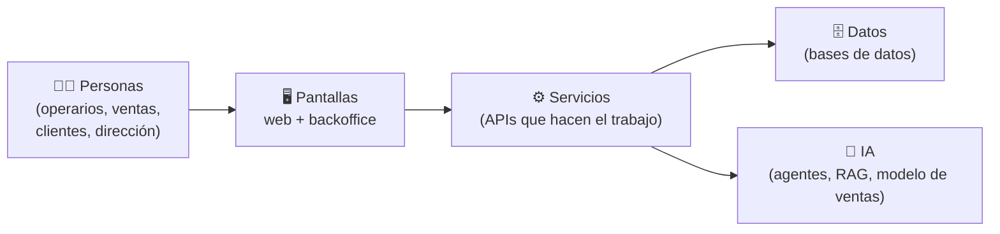
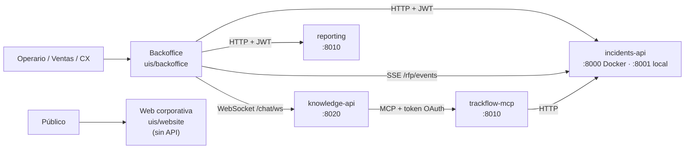
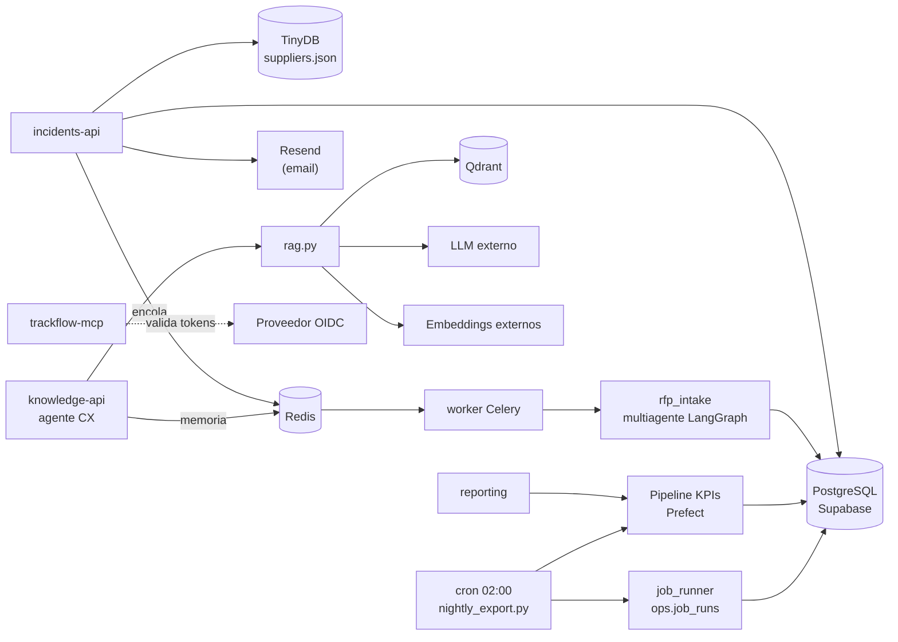

# Manual de estudio de TrackFlow

- **Para:** Marc Juvanteny · preparación de la defensa del proyecto final (IA Engineer)
- **Fecha:** 30 de octubre de 2026
- **Base del manual:** los 35 documentos de la carpeta `Pasos/`, contrastados uno a uno con el código del repositorio en el commit `4eff051` ("Ultimo proyecto").

> **Nota sobre el nombre.** El proyecto se llama **TrackFlow** (de *track*, "seguir/rastrear", y *flow*, "flujo"), no *TruckFlow*. Aparece así en todo el código, en `memory-bank/` y en los BRIEFINGs de `CONTEXT/`. En la defensa, usa siempre "TrackFlow".

> **Cómo leer este manual.** Cada término técnico subrayado como enlace lleva al **diccionario** (sección 17). Cada sección termina con preguntas de autoevaluación, cuyas respuestas están en el **Anexo A**. Cuando algo de un paso **no coincide** con el código actual, lo verás marcado con ⚠️.

---

## Índice

1. [Visión general](#s1)
2. [Arquitectura](#s2)
3. [Stack tecnológico](#s3)
4. [Mapa de carpetas y archivos](#s4)
5. [Los pasos del proyecto](#s5) (sección principal)
6. [Flujo de datos de principio a fin](#s6)
7. [La parte de IA en detalle](#s7)
8. [Agentes, MCPs, skills y workflows](#s8)
9. [Decisiones técnicas](#s9)
10. [Código clave comentado](#s10)
11. [Cómo ejecutar el proyecto desde cero](#s11)
12. [Problemas conocidos y limitaciones](#s12)
13. [Errores comunes](#s13)
14. [Ejercicios prácticos](#s14)
15. [Preguntas de autoevaluación](#s15) (respuestas en el [Anexo A](#anexo-a))
16. [Preguntas probables de la defensa](#s16)
17. [Diccionario de tecnicismos](#s17)

---

<a id="s1"></a>
## 1. Visión general

### El problema, en una frase

TrackFlow es una empresa de **logística de última milla** (la última etapa de un envío: del almacén a la puerta del cliente) con almacenes en **Los Ángeles (EE. UU.)** y **Zaragoza (España)**. Sus clientes son **marcas de e-commerce**: las marcas venden, y TrackFlow guarda su inventario, prepara los pedidos, los envía con 8 transportistas (UPS, FedEx, DHL, MRW, SEUR…) y gestiona las devoluciones.

El problema (según `memory-bank/projectbrief.md`) es que la empresa funciona "a mano":

| Antes del proyecto | Qué pasaba |
| --- | --- |
| Los dos almacenes no se ven entre sí | Cada uno con su sistema; nadie sabe el stock total |
| Seguimiento de envíos manual | Consultar uno a uno los portales de 8 transportistas |
| Devoluciones revisadas una a una | Entre el 18 % y el 25 % del volumen pasa por revisión humana |
| El 80 % de las consultas de clientes las responde una persona | Sin base de conocimiento ni atención fuera de horario |
| La dirección decide con datos de hace 1-2 días | El informe semanal se monta a mano cada domingo |

### Para quién es

TrackFlow (el **proyecto**) es una plataforma interna con varias "puertas de entrada":

- **Operarios de almacén y coordinadores**: usan el **backoffice** (aplicación web interna) para inventario, incidencias y proveedores.
- **Equipo comercial** (Miguel Torres): recibe peticiones de propuesta de clientes (RFP) y las procesa con un flujo de agentes.
- **Atención al cliente** (Valentina Cruz): un **agente de IA** responde consultas de tracking, devoluciones y políticas.
- **Dirección** (Thomas Harry, CEO): KPIs semanales automáticos y una predicción de ingresos.
- **Equipo técnico** (Andrés Kim, CTO): telemetría, seguridad, despliegue.
- **Público en general**: una **web corporativa** con un formulario de presupuesto.

### Qué hace, en sencillo

Piensa en TrackFlow como **un edificio de oficinas con varios departamentos conectados por pasillos**:



1. **Gestiona el día a día**: inventario de dos almacenes (stock calculado al momento), incidencias con un ciclo de vida estricto, directorio de proveedores, usuarios y contraseñas.
2. **Mide todo**: cada clic importante del backoffice genera un "evento" de [telemetría](#g-telemetria) que se guarda y se convierte en informes técnicos y en un informe semanal para dirección.
3. **Predice ingresos**: un modelo de [machine learning](#g-ml) estima la facturación mensual.
4. **Responde preguntas con IA**: un [agente](#g-agente) consulta la base de conocimiento ([RAG](#g-rag)) y herramientas internas ([MCP](#g-mcp)) para contestar a clientes, con memoria y [guardrails](#g-guardrail).
5. **Procesa propuestas comerciales con varios agentes**: lee un PDF, lo clasifica, reparte el trabajo por departamento, redacta, evalúa y espera la aprobación humana.
6. **Avisa en tiempo real**: notificaciones de RFP nuevas ([SSE](#g-sse)) y chat con el agente palabra a palabra ([WebSocket](#g-websocket)).
7. **Se protege**: auditoría [OWASP](#g-owasp), endurecimiento del servidor y un informe [NIST](#g-nist).

> **Idea clave para la defensa.** TrackFlow no es "una app", es un **monorepo** con 2 interfaces, 4 servicios backend, 1 servidor MCP y varios pipelines de datos e IA, construidos en 35 pasos a lo largo de unos 3 meses (julio–octubre de 2026).

### Autoevaluación — Sección 1

- **P1.1** ¿Qué significa "logística de última milla"?
- **P1.2** Nombra tres problemas que tenía TrackFlow antes del proyecto.
- **P1.3** ¿Quiénes son los usuarios del backoffice y quiénes los del agente de atención al cliente?
- **P1.4** ¿Por qué se dice que TrackFlow es un monorepo y no "una app"?

---

<a id="s2"></a>
## 2. Arquitectura

### 2.1 Diagrama general

Para que se lea bien, la arquitectura va en dos diagramas: **(A)** cómo llegan las personas a los servicios y **(B)** qué usa cada servicio por detrás.

**(A) Personas → interfaces → servicios**



**(B) Servicios → datos, IA y servicios externos**



> ⚠️ **Puertos a saber explicar.** `incidents-api` usa el **8000** en Docker y en el `Makefile`, pero el **8001** en los `.env.example` locales. `reporting` (Docker) y el servidor MCP comparten el **8010** por defecto: no pueden arrancar a la vez con esa configuración (ver sección 12).

### 2.2 Las piezas, una por una

**Frontend** (lo que ve la persona)

- **Backoffice** (`uis/backoffice`): aplicación [Next.js](#g-nextjs) para el personal interno. Tiene login, inventario, incidencias, análisis de CSV, proveedores, recepción de RFPs y el chat con el agente. Guarda el [JWT](#g-jwt) en `localStorage` y lo envía en cada llamada (`authFetch` en `lib/auth-context.tsx`).
- **Web corporativa** (`uis/website`): landing pública y formulario de presupuesto. No llama a ninguna API: el formulario solo valida en el navegador.

**Backend** (lo que hace el trabajo)

- **incidents-api** (`services/incidents-api`): el servicio "principal" (un monolito pequeño hecho con [FastAPI](#g-fastapi)). Contiene autenticación (login, registro, recuperación de contraseña), inventario (`routers/inventory.py`), incidencias, proveedores, telemetría (`routers/telemetry.py`), RFPs (`routers/rfp.py`) y el stream de notificaciones SSE (`routers/rfp_events.py`).
- **knowledge-api** (`services/knowledge-api`): el servicio de **IA conversacional**. Contiene el grafo del agente de atención al cliente (`agent_graph.py`), los guardrails, la memoria, el cliente MCP y el chat por WebSocket.
- **reporting** (`services/reporting`): expone los KPIs semanales que calcula el pipeline de Prefect (3 endpoints).
- **worker Celery**: el mismo código que incidents-api, pero arrancado como "trabajador en segundo plano" para tareas lentas (analizar un CSV, procesar una RFP).
- **job_runner** (`services/job_runner`): biblioteca que registra cada ejecución de un job programado (tabla `ops.job_runs`), con bloqueo para evitar dos ejecuciones a la vez.

**Servidor MCP** (`mcps/trackflow-mcp`)

- Expone 5 "herramientas" ([tools](#g-tool)) que un agente puede usar: consultar, crear y actualizar incidencias; consultar inventario; y una de escritura de stock que **siempre rechaza**. Está protegido con [OAuth 2.1](#g-oauth).

**Pipelines de datos e IA** (`data/`)

- `data/process/rag.py`: trocea los documentos de la base de conocimiento y los guarda como vectores en Qdrant.
- `data/pipelines/rag.py`: busca los trozos relevantes y llama al LLM para generar la respuesta.
- `data/pipelines/exec_weekly_inventory_kpis/`: pipeline [ETL](#g-etl) con [Prefect](#g-prefect) que calcula los KPIs semanales.
- `data/pipelines/rfp_intake/`: el sistema **multiagente** de RFPs, hecho con [LangGraph](#g-langgraph).

**Almacenamiento** (dónde viven los datos)

- **Supabase/PostgreSQL**: base de datos relacional en la nube. Inventario (`sku`, `stockentry`, `stockexit`), telemetría (`telemetry_events`), RFPs (`rfp_*`), KPIs (`reporting.*`) y jobs (`ops.job_runs`).
- **TinyDB** (`services/incidents-api/suppliers.json`): un archivo JSON que actúa como base de datos. Usuarios, perfiles, incidencias, proveedores y la cola de tareas fallidas (DLQ).
- **Redis**: memoria rápida. Hace de "buzón" de [Celery](#g-celery) y guarda la memoria aprobada del agente.
- **Qdrant**: [base de datos vectorial](#g-vectordb) con los trozos de la base de conocimiento.

**Servicios externos**

- **Proveedor de LLM** y **de embeddings**: endpoints compatibles con la API de OpenAI (en el curso, el proxy de 4Geeks). ⚠️ El repo **no incluye credenciales reales**; todo lo que usa LLM se verificó con sustitutos (ver sección 7).
- **Resend**: envío del email de recuperación de contraseña.
- **Proveedor OIDC**: emite los tokens del servidor MCP. En desarrollo se usa `dev_idp_server.py`, un emisor propio.

### 2.3 Cómo se comunican

| De → A | Cómo | Ejemplo |
| --- | --- | --- |
| Navegador → servicio | [HTTP](#g-http) + [JSON](#g-json) + JWT en la cabecera `Authorization: Bearer …` | `GET /inventory/products` |
| Servicio → navegador (empuje) | **SSE** (un solo sentido) | aviso "llegó una RFP nueva" |
| Navegador ↔ servicio (dos sentidos) | **WebSocket** | chat con el agente, palabra a palabra |
| Servicio → tarea lenta | **Cola** Redis + worker Celery | analizar un CSV de 1.000 filas |
| Agente → herramientas | **MCP** (JSON-RPC sobre HTTP) con token OAuth | "consulta la incidencia 7" |
| Servicio → otro proceso del mismo repo | importación de Python vía `sys.path` | `knowledge-api` importa `data/pipelines/rag.py` |

> **Analogía.** HTTP es como **pedir un café en la barra**: pides, te lo dan, se acabó. SSE es **la pantalla de turnos de una farmacia**: tú no preguntas, ella te avisa. WebSocket es **una llamada de teléfono**: los dos hablan cuando quieren mientras dure.

### Autoevaluación — Sección 2

- **P2.1** ¿Qué servicio contiene el agente de atención al cliente y cuál el flujo de RFPs?
- **P2.2** ¿Por qué hay tres bases de datos distintas (PostgreSQL, TinyDB, Redis) más Qdrant? Di qué guarda cada una.
- **P2.3** ¿Cuál es la diferencia entre SSE y WebSocket? ¿Dónde se usa cada uno en TrackFlow?
- **P2.4** ¿Por qué el agente no llama directamente a `incidents-api`, sino a través del servidor MCP?

---

<a id="s3"></a>
## 3. Stack tecnológico

Versiones tomadas de los `pyproject.toml` y `package.json` del repo.

### 3.1 Lenguajes y frontend

| Tecnología | Qué es | Para qué se usa en TrackFlow | Por qué esta y no otra |
| --- | --- | --- | --- |
| **Python 3.12** | Lenguaje de programación | Todo el backend, pipelines e IA | Es el estándar de facto en IA/datos (pandas, scikit-learn, LangGraph); lo exige el stack del curso (`techContext.md`) |
| **TypeScript** | JavaScript con tipos | Código del backoffice y la web | Detecta errores antes de ejecutar (p. ej. un campo mal escrito); JavaScript puro no lo hace |
| **Next.js 16.4.3** | Framework web sobre React | Backoffice y web corporativa | Rutas por carpetas, renderizado en servidor (bueno para SEO de la web) y `next/dynamic` para *lazy loading*. Se actualizó desde 16.2.9 en el Hito 11 por vulnerabilidades críticas |
| **React 19** | Librería de interfaces | Componentes de las pantallas | Viene con Next.js; el ecosistema más grande |
| **Tailwind CSS 4** | CSS con clases utilitarias | Estilos (sobre todo en la web) | Rápido de maquetar sin escribir hojas de estilo enormes; el backoffice también usa `globals.css` con variables |

### 3.2 Backend y APIs

| Tecnología | Qué es | Para qué se usa | Por qué |
| --- | --- | --- | --- |
| **FastAPI** | Framework para crear APIs en Python | incidents-api, knowledge-api, reporting | Valida datos automáticamente con Pydantic, genera documentación en `/docs` y soporta async (necesario para SSE/WebSocket). Alternativas: Django (más pesado), Flask (sin validación ni async nativos) |
| **Uvicorn** | Servidor que ejecuta apps ASGI | Arranca cada servicio FastAPI | Es el servidor recomendado para FastAPI |
| **Pydantic** | Validación de datos con tipos | Esquemas de entrada/salida (`extra="forbid"`) | Rechaza campos que no existen o tipos incorrectos antes de tocar la lógica |
| **SQLModel / SQLAlchemy** | ORM: tablas como clases Python | Inventario, telemetría, RFP, reporting | SQLModel une SQLAlchemy y Pydantic (una clase sirve de tabla y de esquema). Consultas parametrizadas: sin inyección SQL |
| **PyJWT** | Crear y verificar JWT | Login y autenticación de todos los servicios | Estándar y ligero. Subido a ≥2.15 en el Hito 11 por vulnerabilidades |
| **Celery + Redis** | Cola de tareas en segundo plano | Analizar CSV, procesar RFPs | El request responde en milisegundos y el trabajo pesado va aparte. Alternativas: BackgroundTasks de FastAPI (mismo proceso, sin reintentos ni DLQ), RQ |
| **Flower** | Panel web de Celery | Ver tareas en cola/ejecución | Viene "de serie" en el ecosistema Celery |
| **TinyDB** | Base de datos en un archivo JSON | Usuarios, incidencias, proveedores | Cero instalación; ya existía de hitos anteriores. Limitaciones serias, ver sección 12 |
| **Supabase (PostgreSQL)** | PostgreSQL gestionado en la nube | Datos de negocio y analítica | Lo exige el stack (`techContext.md`); JSONB, índices GIN, transacciones |
| **Resend** | API de envío de emails | Email de recuperación de contraseña | API simple; si falta la clave, el enlace se imprime en consola (modo desarrollo) |

### 3.3 Datos, ML e IA

| Tecnología | Qué es | Para qué se usa | Por qué |
| --- | --- | --- | --- |
| **pandas** | Tablas de datos en Python | Telemetría, KPIs, ventas | Estándar para análisis tabular |
| **Prefect 3** | Orquestador de pipelines | Pipeline semanal de KPIs | Reintentos, estados y caché por tarea con decoradores (`@flow`, `@task`). Alternativa: Airflow (más pesado de montar) |
| **scikit-learn** | Librería de ML clásico | `RandomForestRegressor`, `LinearRegression`, `TimeSeriesSplit` | Suficiente para 120 filas; XGBoost aportaría poco con tan pocos datos |
| **matplotlib** | Gráficos | Predicción vs. real, curva de aprendizaje | Estándar |
| **Qdrant 1.13** | Base de datos vectorial | Guardar y buscar trozos de documentos por significado | Open source, se autoaloja en Docker, cliente Python sencillo |
| **OpenAI SDK** | Cliente de API de LLM | Embeddings y generación (endpoint compatible) | Cualquier proveedor "compatible con OpenAI" sirve cambiando una URL |
| **LangGraph 1.2** | Framework de grafos de agentes | Agente CX y flujo multiagente de RFPs | Estados, ramas condicionales, ejecución en paralelo, checkpoints e `interrupt()` para aprobación humana. Alternativa: cadenas lineales (no permiten ciclos ni pausas) |
| **langgraph-checkpoint-postgres** | Guardado de estado del grafo en Postgres | Aprobaciones de RFP que sobreviven a reinicios | Sin esto, una pausa de aprobación se perdería al reiniciar |
| **MarkItDown** | Conversor de documentos a Markdown (Microsoft) | Leer los PDF de RFP | Convierte PDF a texto estructurado para los agentes |
| **py-readability-metrics** | Métricas de legibilidad (Flesch) | Evaluar borradores de RFP | La pidió el BRIEFING del Hito 9 |
| **FastMCP + mcpauth** | Librerías para servidores MCP y OAuth | Servidor `trackflow-mcp` | El checklist prohibía la autenticación integrada de FastMCP; mcpauth implementa OAuth 2.1 |
| **langchain-mcp-adapters** | Cliente MCP para LangChain/LangGraph | El agente consume las tools del MCP | Conecta el grafo con el servidor MCP sin escribir JSON-RPC a mano |

### 3.4 Infraestructura, calidad y seguridad

| Tecnología | Qué es | Para qué se usa | Por qué |
| --- | --- | --- | --- |
| **Docker / Docker Compose** | Contenedores | Levantar todo el stack con un comando | Mismo entorno en cualquier máquina |
| **uv** | Gestor de dependencias Python | `uv sync`, `uv lock`, `uv run` | Mucho más rápido que pip y crea `uv.lock` reproducible |
| **pytest** | Framework de tests | ~270 funciones de test en 6 suites | Estándar en Python |
| **ESLint / tsc** | Revisión de código JS/TS | Lint y comprobación de tipos del frontend | Detecta errores de estilo y de tipos |
| **ufw** | Firewall de Ubuntu | Endurecimiento del servidor (Hito 11) | Simple; se documentó cómo evitar que Docker se lo salte |
| **nginx** | Servidor web / proxy inverso | Plantilla TLS (HTTPS) del Hito 11 | La "puerta" pública con HTTPS delante de los servicios |
| **pip-audit / npm audit / detect-secrets** | Escáneres de seguridad | Dependencias vulnerables y secretos en el código | Evidencia reproducible del antes y el después |
| **Playwright / Chromium** | Navegador automatizable | Verificaciones de UI y generación de este PDF | Prueba la app como un usuario real |

### Autoevaluación — Sección 3

- **P3.1** ¿Para qué sirve Pydantic y qué hace `extra="forbid"`?
- **P3.2** ¿Por qué se usa Celery en vez de hacer el trabajo dentro del endpoint?
- **P3.3** ¿Qué aporta LangGraph frente a llamar al LLM directamente?
- **P3.4** ¿Por qué Random Forest y no XGBoost en el modelo de ventas?
- **P3.5** ¿Qué es uv y qué problema resuelve el archivo `uv.lock`?

---

<a id="s4"></a>
## 4. Mapa de carpetas y archivos

Leyenda: 🔑 = clave para entender o defender el proyecto · ⚙️ = configuración · 📄 = documentación · 🧪 = tests · 💤 = plantilla vacía o secundario.

```text
MarcJuvanteny_ai-engineering-company-project-monorepo/
├── AGENTS.md                      📄🔑 Reglas para agentes IA: leer memory-bank, flujo antes de commit, rutas protegidas
├── README.md / README.es.md       📄 Plantilla general del curso (4Geeks)
├── CONTEXT/                       📄🔑 BRIEFINGs de cada hito (lo que pedía el "cliente")
│   ├── CONTEXT.md, CONTEXT-trackflow.md, CONTEXT5..12.md, CONTEXTPredicción.md, sales.md
├── memory-bank/                   📄🔑 Memoria del proyecto para los agentes IA
│   ├── projectbrief.md            ·  negocio y problema
│   ├── techContext.md             ·  stack y decisiones técnicas
│   └── progress.md                ·  hitos especificados
├── Pasos/                         📄🔑 35 documentos: un registro por cada paso (base de este manual)
├── docs/
│   ├── ARQUITECTURE_PROPOSAL.md   📄 Propuesta inicial de arquitectura (⚠️ difiere de lo construido, ver 9)
│   ├── company-knowledge-base/    🔑 4 documentos que el RAG indexa (SLA, devoluciones, carriers, almacenaje)
│   ├── rag/rag-design.md          📄 Diseño del RAG
│   └── manual-estudio/            📄 Este manual
├── uis/                           🔑 FRONTEND
│   ├── backoffice/src/
│   │   ├── app/                   🔑 Rutas (una carpeta = una URL); (protected)/ exige login
│   │   ├── components/            🔑 Paneles: inventario, incidencias, RFP, chat…
│   │   ├── lib/                   🔑 auth-context.tsx, inventory.ts, use-cx-chat.ts, use-rfp-ticket-stream.ts
│   │   └── services/telemetry.ts  🔑 Cola y envío de eventos de telemetría
│   ├── website/                   Landing pública + formulario de presupuesto
│   ├── Dockerfile, start.sh       ⚙️ Contenedor de ambas apps
├── services/                      🔑 BACKEND
│   ├── incidents-api/             🔑 main.py, routers/, models.py, auth_service.py, tasks.py, celery_app.py
│   │   └── suppliers.json         ⚙️⚠️ "Base de datos" TinyDB (versionada en git, ver 12)
│   ├── knowledge-api/             🔑 agent_graph.py, guardrails.py, memory_*.py, chat_*.py, mcp_client.py
│   ├── reporting/                 Endpoints de KPIs semanales
│   ├── job_runner/                Control de jobs programados (tabla ops.job_runs)
│   └── Dockerfile                 ⚙️
├── mcps/trackflow-mcp/            🔑 Servidor MCP: server.py, auth.py, scopes.py, tools/
├── data/
│   ├── process/rag.py             🔑 Indexación del RAG (trocear + vectorizar)
│   ├── pipelines/
│   │   ├── rag.py                 🔑 Recuperación + generación
│   │   ├── exec_weekly_inventory_kpis/  🔑 Pipeline Prefect de KPIs
│   │   ├── rfp_intake/            🔑 Sistema multiagente de RFPs
│   │   └── pipeline.py            CLI del pipeline de KPIs
│   ├── raw/                       Datos de entrada (CSV de ventas, PDFs subidos)
│   └── eval/                      🔑 Evaluaciones: Recall@3, métricas del modelo, gráficos
├── scripts/                       Scripts sueltos: seed, nightly_export, train/evaluate_sales_forecast, rfp_reprocess
├── tests/
│   ├── pipelines/                 🧪 150 tests (RAG, agente, memoria, guardrails, RFP, ventas)
│   └── services/                  🧪 64 tests (SSE, WebSocket, seguridad)
├── infra/
│   ├── nightly_export.cron        ⚙️ Expresión cron (02:00)
│   └── hardening/                 🔑 provision.sh, verify.sh, nginx-trackflow.conf (Hito 11)
├── audit/
│   ├── before/, after/            💤 Lighthouse (solo README: nunca se midió, ver paso 18)
│   ├── security/                  🔑 Evidencia OWASP antes/después (Hito 11)
│   └── security-ai/               🔑 Evidencia seguridad por diseño (Hito 12)
├── rfp-requests/trackflow/        3 PDF de muestra (ModaViva, Luna Cosmetics, pitch inválido)
├── docker-compose.yml             ⚙️🔑 8 servicios: uis, backend, worker, redis, flower, reporting, qdrant, knowledge-api
├── Makefile                       ⚙️ Atajos: make up, make logs, make health…
├── agents/                        💤 Plantilla de agente (agent.py está VACÍO)
├── skills/                        💤 Plantillas de skills (SKILL.md vacío; data-analysis tiene 2 archivos de ejemplo)
├── .agents/Verificaciondecontratos.md  📄 Una skill escrita: verificar contratos compartidos antes de commit
├── workflows/, internal/          💤 Solo README (rutas protegidas, sin contenido)
├── packages/shared/               TypeScript de un hito anterior (hito2): tipos y utilidades
├── shared/                        💤 Solo README
├── analyze.py, incident_analysis.py   Script de análisis de incidencias (Hito 7) — reutilizado por el seed y Celery
├── telemetry-plan.md, event-shcemas.json  📄 Plan y contrato de telemetría
├── AUDIT.md, REPORT.md, CACHING_REPORT.md, INVENTARIO_COMPLETO_PROYECTO.md   📄 Informes
├── .claude/settings.local.json    ⚙️ Permisos locales de Claude Code
├── .gitignore                     ⚙️ Qué no se sube a git
└── __pycache__/, .pytest_cache/, .vscode/   ⚙️ Generados automáticamente / editor (ignorar)
```

> **Tip para la defensa.** Si te preguntan "¿dónde está X?", piensa en capas: **pantalla** → `uis/`; **API** → `services/`; **lógica de datos o IA reutilizable** → `data/`; **herramientas del agente** → `mcps/`; **pruebas** → `tests/`.

### Autoevaluación — Sección 4

- **P4.1** ¿En qué carpeta está la lógica del sistema multiagente de RFPs? ¿Y su endpoint HTTP?
- **P4.2** ¿Qué contiene `memory-bank/` y quién lo lee?
- **P4.3** ¿Qué carpetas son plantillas vacías y por qué es importante saberlo antes de la defensa?
- **P4.4** ¿Para qué sirve la carpeta `audit/security/`?
