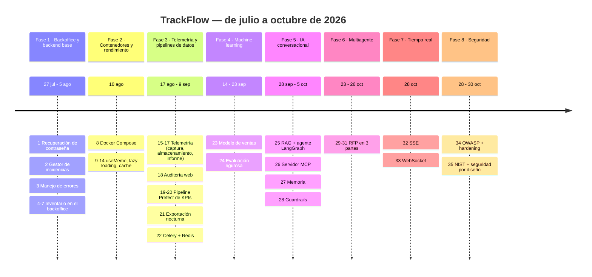

#### Paso 18 — Auditoría de rendimiento web

- **Qué se pidió.** Medir con [Lighthouse](#g-lighthouse) antes y después, analizar el código, corregir y entregar `AUDIT.md` y `REPORT.md`.
- **Qué se hizo.** `AUDIT.md` con 6 problemas y su causa raíz, y dos casos de código repetido. Se creó el *custom hook* `useApiSubmit` (`uis/backoffice/src/lib/use-api-submit.ts`).
- ⚠️ **A medias:**
  1. **Nunca se midió Lighthouse**: no había Chrome en el Codespace. Las carpetas `audit/before/` y `audit/after/` solo tienen un README y las tablas de `AUDIT.md` dicen "_pendiente_".
  2. `useApiSubmit` se aplicó en **2 de 4** formularios (`forgot-password-form` y `reset-password-form`, no en `login-form` ni `register-form`).
  3. El componente `<FormField>` propuesto **no existe**.
- **Conceptos nuevos.** [Lighthouse](#g-lighthouse), Core Web Vitals (LCP, CLS, INP), [custom hook](#g-hook), refactorización.
- **Para la defensa.** Sé honesto: es el paso más incompleto del proyecto. Explica la causa (falta de navegador en el entorno) y qué harías (ver sección 12).

#### Paso 19 — Diseño del pipeline de reporting ejecutivo

- **Qué se hizo.** Un documento de diseño **sin código** en 5 fases:
  - **Estado actual y brecha**: el informe técnico del paso 17 no responde preguntas de negocio.
  - **Pipeline**: tres KPIs semanales por almacén y marca: `fulfillment_rate` (tasa de cumplimiento), `discrepancy_frequency` (discrepancias por 1.000 movimientos) y `receipt_to_dispatch_cycle_time_h` (horas de recepción a despacho).
  - **Idempotencia**: tabla de *staging* y luego [UPSERT](#g-upsert) en una transacción, con clave natural `(iso_week, warehouse, client_id)`.
  - **Mapeo a Prefect**: 1 flow y 5 tasks.
  - **Servicio**: `services/reporting` con 3 endpoints.
- **Por qué.** El informe semanal de dirección se montaba a mano cada domingo.
- **Conceptos nuevos.** [ETL](#g-etl), [KPI](#g-kpi), staging, UPSERT, semana ISO, clave natural.

#### Paso 20 — Implementación del pipeline (Prefect) y `services/reporting`

- **Qué se hizo.** El paquete `data/pipelines/exec_weekly_inventory_kpis/`:
  - `extract.py`, `transform.py` (funciones puras) y `load.py` (staging + UPSERT + log);
  - `flow.py`, con reintentos justificados por tarea (3 en la extracción, 0 en la transformación porque un fallo ahí es un bug, 2 en la carga) y [caché](#g-cache) de 1 h en la transformación;
  - un paso opcional (`export_eval_snapshot`) que, si falla, no tumba el flow (`return_state=True`);
  - la CLI `data/pipelines/pipeline.py`;
  - el servicio `services/reporting` (`GET /status`, `POST /run` solo para admin/manager, `GET /kpis`).
- **Desviaciones del diseño.**
  - `POST /run` usa `BackgroundTasks` de FastAPI en vez de un *deployment* de Prefect, porque no había servidor Prefect.
  - La carpeta lleva guiones bajos porque Python no admite guiones en nombres de módulo.
- ⚠️ **Nunca se ejecutó contra Supabase real** (seguía pausado): se probó con SQLite en memoria y `prefect_test_harness` (19 tests en `data/pipelines/tests/`).
- **Conceptos nuevos.** [Prefect](#g-prefect) (flow, task, retries), función pura, staging, transacción.

#### Paso 21 — Exportación nocturna y control de jobs

- **Qué se hizo.**
  - **Script** `scripts/nightly_export.py`: exporta la telemetría del día anterior a `data/raw/telemetry_<fecha>.csv` y lanza el pipeline del paso 20 como subproceso.
  - **Registro**: cada ejecución queda en `ops.job_runs` (`services/job_runner/`).
  - **Bloqueo**: un índice único parcial (`UNIQUE (job_name) WHERE status='processing'`) impide dos ejecuciones simultáneas.
  - **Idempotencia**: si ya hay una ejecución `completed` para esa fecha, no se repite.
  - **Captura de fallos**: se captura `BaseException` (incluye Ctrl+C) para que ninguna fila quede atascada en `processing`.
  - **Cron**: `infra/nightly_export.cron` ejecuta el script a las 02:00.
- ⚠️ La línea de cron está **documentada pero no instalada** en ningún servidor.
- **Conceptos nuevos.** [Cron](#g-cron), [lock](#g-lock), índice único parcial, logging estructurado.

#### Paso 22 — Celery + Redis para el análisis de CSV

- **Qué se hizo.**
  - **Cola**: `POST /api/incidents/analyze` ya no procesa el CSV en el momento. Solo valida lo barato (extensión, no vacío, UTF-8), **encola** una tarea Celery y responde `202 Accepted` con un `task_id`. El cliente consulta `GET /tasks/{task_id}`.
  - **Reintentos**: hasta 3, con espera creciente (2, 4 y 8 s). Un CSV mal formado no se reintenta, porque fallaría igual.
  - **[DLQ](#g-dlq)**: los fallos definitivos se guardan en la tabla `task_dlq` (TinyDB).
  - **Flower**: monitorización de las tareas.
- **Bug real corregido.** En `docker-compose.yml`, la opción `--broker` iba después de `flower` y Flower la ignoraba en silencio (se conectaba a un RabbitMQ inexistente).
- 🔄 **Cambió después.** Redis y Flower se ligaron a `127.0.0.1` en el paso 34, porque estaban expuestos sin contraseña.
- **Conceptos nuevos.** [Cola de tareas](#g-cola), [worker](#g-worker), [broker](#g-broker), backoff exponencial, DLQ, `202 Accepted`.
- **Conexiones.** El mismo Celery procesa las RFPs en los pasos 29-30.

#### Paso 23 — Modelo de predicción de ingresos

- **Qué se hizo.** `scripts/train_sales_forecast.py`:
  - un `RandomForestRegressor` que predice el ingreso mensual;
  - división temporal: 8 años de entrenamiento (2016-2023) y 2 de prueba (2024-2025), **sin barajar**;
  - 4 métricas: MSE, PSI, Gini y "K2" (interpretado como R²);
  - un gráfico de la predicción con su rango de variabilidad.
- **El dataset no existía.** Se generó sintéticamente (`scripts/generate_trackflow_sales_dataset.py`, semilla 42) siguiendo las reglas del BRIEFING.
- **Bugs reales corregidos.**
  1. **Un Random Forest no puede extrapolar una tendencia creciente** (R² = −6,5). Se descompuso en tendencia (regresión log-lineal) y residuo estacional (Random Forest).
  2. **`time_index` volvía a empezar en 0 en el conjunto de prueba.** Se corrigió con un `base_year` fijo.
  3. **El PSI se disparaba con 10 *buckets* y solo 24 meses.** Se pasó a 5 *buckets*.
- 🔄 En el paso 24 el dataset sintético se sustituyó por el **real** (`CONTEXT/sales.md`).
- **Conceptos nuevos.** [Regresión](#g-regresion), [Random Forest](#g-rf), [train/test split](#g-split), [fuga de datos](#g-leakage), [MSE/RMSE](#g-mse), [R²](#g-r2), [PSI](#g-psi), [Gini](#g-gini), [escalado](#g-escalado).

#### Paso 24 — Evaluación rigurosa del modelo

- **Qué se hizo.**
  - **Datos y features**: dataset real; nuevas variables de *lag* (`lag_1`, `lag_12`) y medias móviles (`rolling_mean_3`, `rolling_std_3`), calculadas solo con meses anteriores.
  - **Validación cruzada temporal**: [`TimeSeriesSplit`](#g-tscv) de 5 *folds*, con un `assert` que comprueba que ningún *fold* mezcla futuro y pasado.
  - **Diagnóstico**: curva de aprendizaje y MAE/RMSE en entrenamiento y validación, con informe en `data/eval/evaluation_report.md`.
- **Resultado actual** (`data/eval/sales-forecast/`):

  | Métrica | Valor | Lectura |
  | --- | --- | --- |
  | R² (prueba 2024-2025) | 0,948 | Explica el 95 % de la variación |
  | RMSE | 3,0 % del ingreso mensual medio | Error típico pequeño |
  | Gini normalizado | 0,935 | Ordena muy bien meses altos y bajos |
  | PSI (`us_share`) | 0,05 | Sin cambio en la mezcla EE. UU./España |
  | RMSE entrenamiento vs. validación cruzada | 22.517 € vs. 46.598 € (×2,07) | **Sobreajuste** |

- ⚠️ La acción correctiva propuesta (subir `min_samples_leaf`, bajar `max_depth`) **no se aplicó**: el modelo sigue con `max_depth=6, min_samples_leaf=2`.
- **Conceptos nuevos.** [Validación cruzada](#g-cv), [sobreajuste](#g-overfitting), curva de aprendizaje, [lag](#g-lag), MAE.

#### Paso 25 — RAG, grafo del agente y tools

- **Qué se hizo.** El paso más grande (54 KB). En orden:
  1. **Documentos fuente**: los 4 documentos de `docs/company-knowledge-base/` (SLA, devoluciones, cobertura de carriers, tarifas de almacenaje). No existían y se redactaron con datos ya presentes en el repo.
  2. **Indexación** (`data/process/rag.py`): trocea por encabezado `##` (20 trozos en total), vectoriza con `embed()` y guarda en la colección Qdrant `trackflow_knowledge` con IDs deterministas (UUID5), de modo que indexar dos veces no duplica.
  3. **Recuperación y generación** (`data/pipelines/rag.py`): `retrieve()` (los `k` más parecidos por encima de `min_score=0.5`), `generate_answer()` y `query()`.
  4. **API**: `POST /knowledge/query` en `services/knowledge-api`.
  5. **Pantalla**: página `/knowledge` en el backoffice y modo oscuro.
  6. **Tests y evaluación**: 17 tests y **Recall@3 = 80 %** (8 de 10 preguntas).
  7. **Agente LangGraph** (`agent_graph.py`): `POST /agent/query`, con `classify_intent` decidiendo entre RAG, tool de incidencias, tool de inventario o ambas.
  8. **Trazas**: un JSON por ejecución en `data/eval/agent-traces/`.
- ⚠️ **Sin credenciales reales.** El Recall@3 se midió con un **embedding léxico local** (que cuenta palabras, no entiende significado), y de los 8 aciertos solo 3 superan `min_score`. Ninguna respuesta se generó con un LLM real.
- 🔄 **Cambió después:**
  - las tools HTTP directas (`services/knowledge-api/tools/`) ❌ se **eliminaron** en el paso 26 (sustituidas por MCP);
  - el panel `/knowledge` dejó de llamar a `/knowledge/query` y pasó a ser el **chat por WebSocket** del paso 33;
  - el paso 34 exigió JWT;
  - el paso 35 delimitó el prompt.
- **Conceptos nuevos.** [RAG](#g-rag), [embedding](#g-embedding), [chunking](#g-chunk), [similitud coseno](#g-coseno), [base vectorial](#g-vectordb), [LLM](#g-llm), [prompt](#g-prompt), [system prompt](#g-system-prompt), [Recall@k](#g-recall), [grafo de agente](#g-langgraph), [checkpoint](#g-checkpoint), [traza](#g-traza).

#### Paso 26 — Servidor MCP

- **Qué se hizo.** `mcps/trackflow-mcp` con [FastMCP](#g-fastmcp) y 5 tools:
  - `query_incident`, `create_incident_ticket` y `update_incident_status` (este último solo por el endpoint del ciclo de vida);
  - `query_inventory`;
  - `update_inventory_stock`, que **siempre rechaza** con `read_only_tool`, para que el rechazo sea explícito y visible.
- **Seguridad.**
  - **OAuth 2.1** con `mcpauth`: ningún cliente sin token puede ni listar las tools.
  - **[Scopes](#g-scope) por tool**: `incidents:read`, `incidents:write`, `inventory:read`.
  - **Códigos de error documentados**.
  - **Registro** de cada invocación (tool, cliente y resultado).
- **Migración del agente.** Ahora llama a las tools a través del MCP (`mcp_client.py`, con `langchain-mcp-adapters`), y se eliminó el código HTTP antiguo.
- ⚠️ **Pendiente:** la prueba manual en *MCP Playground* exigía publicar el puerto del Codespace y quedó para el desarrollador. Tampoco se probó con un proveedor OIDC real; se usó el emisor de desarrollo `dev_idp_server.py`, con claves RSA reales.
- **Conceptos nuevos.** [MCP](#g-mcp), [tool](#g-tool), [OAuth 2.1](#g-oauth), [OIDC](#g-oidc), scope, mínimo privilegio, [JSON-RPC](#g-jsonrpc).

#### Paso 27 — Memoria del agente

- **Qué se hizo.** El agente aprende correcciones como "Nacex ya no cubre esa zona de Aragón":
  1. **Propone** recordarlo en la misma respuesta (nodo `propose_memory`).
  2. En el turno siguiente, el usuario **aprueba o rechaza** (`classify_memory_decision`, que no se deja engañar por un "sí" dentro de otra palabra).
  3. Solo si aprueba, se escribe en **Redis** (`agent_memory:Nacex:Spain`), con caducidad de 180 días y un máximo de 200 entradas.
  4. Toda decisión queda auditada (`memory_audit.py`).
- **Bugs reales corregidos.**
  - El *checkpointer* se recreaba en cada petición, así que la propuesta se perdía entre turnos.
  - Una memoria ya aprobada se volvía a proponer en bucle.
  - El país se deducía mal ("Aragón" no contiene "Zaragoza"); se resolvió con un mapa carrier → país.
- ⚠️ La sección "Decisiones de diseño" del checklist no llegó en la captura y no se implementó.
- **Conceptos nuevos.** [Memoria de agente](#g-memoria), TTL, consolidación, auditoría, *human-in-the-loop*.

#### Paso 28 — Guardrails y harness

- **Qué se hizo.** Asegurar el mismo agente:
  - **System prompt** (`AGENT_SYSTEM_PROMPT`): separa instrucciones y datos y declara el dominio.
  - **Guardrails de entrada** (`input_guard`): cambio de instrucciones (*jailbreak*), uso personal (poemas, tareas), mezcla de políticas entre países y pedido no autorizado.
  - **Preguntas casuales**: se responden y se redirigen al dominio de la empresa.
  - **Contenido externo**: se sanea (`sanitize_external_content`).
  - **Salida**: se valida antes de enviarla (`output_guard`).
  - **Auditoría**: registro de cada activación y `GET /agent/guardrails/summary`.
- 🔄 **Cambió después:**
  - la lista de pedidos autorizados la enviaba **el propio cliente** (`authorized_order_ids`) y omitirla desactivaba el control; el paso 34 la movió al servidor;
  - el paso 35 añadió la normalización de texto, porque un carácter invisible evadía todos los patrones.
- **Conceptos nuevos.** [Guardrail](#g-guardrail), [jailbreak](#g-jailbreak), [prompt injection](#g-injection), harness.

#### Paso 29 — RFP parte 1: recepción y análisis

- **Qué se hizo.** Un flujo multiagente dedicado (`data/pipelines/rfp_intake/`), separado del agente de atención al cliente:
  1. Se sube un PDF desde `/rfp`.
  2. `POST /rfp/tickets` crea el ticket en estado `analizando` y lo encola en Celery.
  3. MarkItDown convierte el PDF a Markdown.
  4. El **clasificador** decide si es una RFP válida (petición de un cliente) o no (por ejemplo, el *pitch* de tarifas de un transportista) y extrae los metadatos.
  5. El **orquestador** reparte el trabajo solo entre los departamentos necesarios (`warehouse`, `lastmile`, `reverse`).
  6. Un **worker** por departamento extrae los aspectos clave y **nunca inventa cifras**: si falta un dato, añade una pregunta abierta.
  7. El **sintetizador** resume "qué pedir a quién".
  8. El estado pasa a `analisis_completo` o `descartado`, con el motivo.
- **Patrón.** [Orchestrator-worker-synthesizer](#g-orchestrator).
- **Datos de prueba.** Los 3 PDF de muestra no existían y se generaron con reportlab. Se verificó con Postgres, Redis y Celery reales.
- 🔄 Desde el paso 32, al clasificar como válida se emite un evento en tiempo real.
- **Conceptos nuevos.** [RFP](#g-rfp), multiagente, fan-out, estado del ticket.

#### Paso 30 — RFP parte 2: generación y evaluación

- **Qué se hizo.**
  - **Generación**: un generador por departamento escribe su sección de la propuesta económica.
  - **Evaluación**: 3 **evaluadores en paralelo de verdad** (tres aristas desde `START` en LangGraph):
    - **legibilidad** (Flesch, con umbral 10 porque la fórmula está calibrada para inglés);
    - **pertinencia** (¿menciona todo lo que pidió el cliente?);
    - **cumplimiento** (moneda correcta según el país, SLA declarado, devoluciones ≥ 48 h, tabla de descuentos y nunca revelar tarifas negociadas).
  - **Ciclo de corrección**: si una sección falla, vuelve a su generador con un `feedback_for_generator` concreto, hasta 3 intentos. Si no lo consigue, la sección queda en `needs_human_review` y el ticket nunca se descarta.
- **Conceptos nuevos.** Evaluador, ciclo generador-evaluador, ejecución en paralelo.
- ⚠️ Los generadores y evaluadores son **plantillas y reglas deterministas**, no un LLM (sin credenciales).

#### Paso 31 — RFP parte 3: aprobación humana y cierre

- **Qué se hizo.**
  - **Aprobación**: cada responsable de departamento (Ana Whitfield, Carlos Vega, Sofía Ramos) aprueba su sección **por separado**, con [`interrupt()`](#g-interrupt) de LangGraph. El grafo se **pausa** de verdad y se reanuda con `Command(resume=...)`.
  - **Persistencia**: el estado se guarda en Postgres con `PostgresSaver` (se comprobó reanudando desde una conexión nueva).
  - **Arbitraje**: un nodo determinista resuelve 3 conflictos entre secciones (volumen frente a capacidad de almacén, devoluciones en menos de 48 h y moneda incorrecta), con árbitro fijo Miguel Torres.
  - **Cierre**: el documento final solo se genera si **todos** aprueban.
  - **Trazabilidad**: cada nodo se registra en `RFPNodeTrace`.
- **Bugs reales corregidos.**
  - Una carrera entre ramas que duplicaba la interrupción.
  - El arbitraje de volumen no cambiaba el número real.
- ⚠️ La UI no se probó haciendo clic en un navegador real. El docstring de `RFPNodeTrace` menciona `GET /rfp/tickets/{id}/trace`, que **no existe**.
- **Conceptos nuevos.** [Human-in-the-loop](#g-hitl), `interrupt`, checkpointer persistente, arbitraje.

#### Paso 32 — Notificación en tiempo real de RFPs (SSE)

- **Qué se hizo.** `GET /rfp/events` (`routers/rfp_events.py`):
  - emite un evento con nombre `rfp_ticket_created` en el mismo momento en que una RFP se clasifica como válida;
  - el evento se guarda primero en una tabla *outbox* (`rfp_ticket_events`) en la misma transacción que los metadatos;
  - cada evento tiene un `id`, de modo que, si el navegador se desconecta, al volver envía `Last-Event-ID` y el servidor le reenvía lo que se perdió;
  - envía *keep-alive* cada 15 s y está protegido con JWT.
- **En el navegador.** Se usa `fetch` + `ReadableStream` (no `EventSource`, porque `EventSource` no puede enviar el JWT), con reconexión con espera creciente y sin duplicar tickets.
- **Conceptos nuevos.** [SSE](#g-sse), [outbox](#g-outbox), `Last-Event-ID`, keep-alive, backoff.

#### Paso 33 — Chat con el agente por WebSocket

- **Qué se hizo.** `WS /chat/ws?session_id&token`:
  - la respuesta llega **token a token**, con el modo `custom` de LangGraph;
  - si el usuario escribe mientras el agente responde, la generación se **aborta de verdad** (se cancela la tarea y el *stream* del LLM), el texto parcial queda marcado como `interrupted` y empieza un turno nuevo;
  - un patrón [pub/sub](#g-pubsub) en memoria (`chat.<session_id>`) separa al agente (productor) de las conexiones (consumidores);
  - al reconectar llega primero un `session_snapshot` con el historial y luego los tokens nuevos, sin duplicados.
- 🔄 En los pasos 34-35 se añadieron el ACL de pedidos y el *rate limit* a cada turno.
- **Conceptos nuevos.** [WebSocket](#g-websocket), [streaming](#g-streaming), pub/sub, abort, rehidratación.

#### Paso 34 — Auditoría OWASP Top 10 y endurecimiento del servidor

- **Qué se hizo.** Las 10 categorías de [OWASP](#g-owasp) evaluadas por separado en backend, frontend y sistema agéntico. Hallazgos críticos corregidos:

  | # | Hallazgo | Corrección |
  | --- | --- | --- |
  | C1 | Cualquiera podía registrarse como `admin` | Rol privilegiado solo lo asigna un admin |
  | C2 | Agente anónimo, y el cliente decidía qué pedidos podía ver | JWT obligatorio + lista de pedidos en el servidor, cerrada por defecto |
  | C3 | Inventario y tracking legibles sin login | JWT en las lecturas |
  | C4 | `next` con varios RCE críticos y otras dependencias vulnerables | Actualizadas: 0 vulnerabilidades en runtime |
  | C5 | Redis sin contraseña y Flower expuestos | Ligados a `127.0.0.1` |

  Además: el agente solo puede usar tools de lectura, las contraseñas pasan a **scrypt**, se reconocen más formas de pedido ("order 45821") y se sanea el nombre de los PDF subidos.
- **Endurecimiento del servidor** (`infra/hardening/`):
  - usuario `trackops` sin root y con sudo limitado;
  - SSH sin root y sin contraseña;
  - permisos de carpetas;
  - firewall ufw (22/80/443);
  - Docker ligado a loopback;
  - plantilla nginx con TLS.

  Probado en un Ubuntu 24.04 real (contenedor): 26/26 controles en verde.
- **Evidencia.** Los tests se ejecutaron sin la corrección (fallaban) y con ella (pasaban). Ver `audit/security/`.
- **Conceptos nuevos.** [OWASP](#g-owasp), [control de acceso](#g-acl), [RCE](#g-rce), [hardening](#g-hardening), [firewall](#g-firewall), [TLS](#g-tls), [SSH](#g-ssh), CVE.

#### Paso 35 — Seguridad por diseño e informe NIST

- **Qué se hizo.**
  - **Inventario de IA**: 13 sistemas con su responsable de negocio y técnico, y una matriz de qué controla un tercero (el proveedor del LLM) y qué controla TrackFlow.
  - **Hallazgo principal**: un solo carácter invisible (`U+200B`) evadía todos los guardrails. Se corrigió con una normalización de texto (`input_sanitization.py`).
  - **Separación del prompt**: bloques delimitados `<pregunta_del_cliente>` y `<contexto_recuperado>`, con `<` y `>` escapados.
  - **Validación de llamadas a tools** antes de ejecutarlas.
  - **Rate limit** por usuario (429).
  - **Trazabilidad**: registro de decisiones del agente con su motivo y sin datos personales.
  - **Borrados**: confirmación explícita (`X-Confirm-Action`, 428 si falta).
  - **Secreto JWT**: mínimo de 32 caracteres.
  - **Informe [NIST CSF](#g-nist)** con las 6 funciones y 11 brechas documentadas con su mitigación.
- **Conceptos nuevos.** [Seguridad por diseño](#g-secdesign), [rate limiting](#g-ratelimit), [normalización Unicode](#g-unicode), [RGPD](#g-rgpd), [CCPA](#g-ccpa), [NIST CSF](#g-nist).

### 5c. Fases del proyecto (línea temporal)

> **Hilo conductor.** Primero se construye la **operación** (inventario, incidencias), después se **mide** (telemetría, pipelines), después se **predice** (ML), después se **automatiza con IA** (RAG, agentes, multiagente), después se hace **en tiempo real** y por último se **asegura**. Cada fase usa lo que construyó la anterior: los eventos de telemetría alimentan el pipeline de KPIs; el inventario y las incidencias son las tools del agente; Celery, nacido para los CSV, procesa después las RFPs.

### Autoevaluación — Sección 5

- **P5.1** ¿Por qué el stock nunca se guarda en una columna, sino que se calcula?
- **P5.2** ¿Qué tres pasos quedaron a medias o con piezas sin terminar, y por qué?
- **P5.3** Explica con tus palabras qué cambió en el agente entre los pasos 25 y 26.
- **P5.4** ¿Qué es una DLQ y en qué paso aparece?
- **P5.5** ¿Por qué el modelo de ventas está "sobreajustado" y qué harías para corregirlo?
