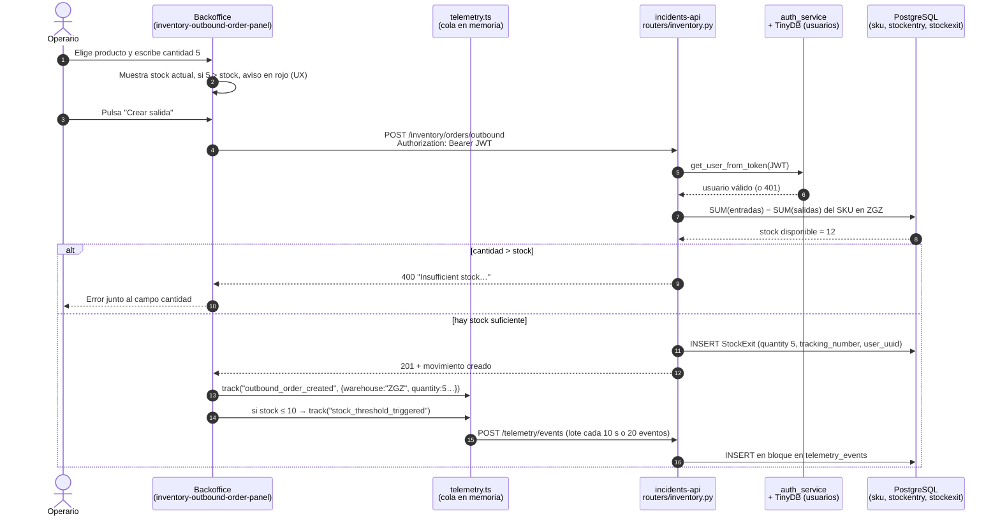
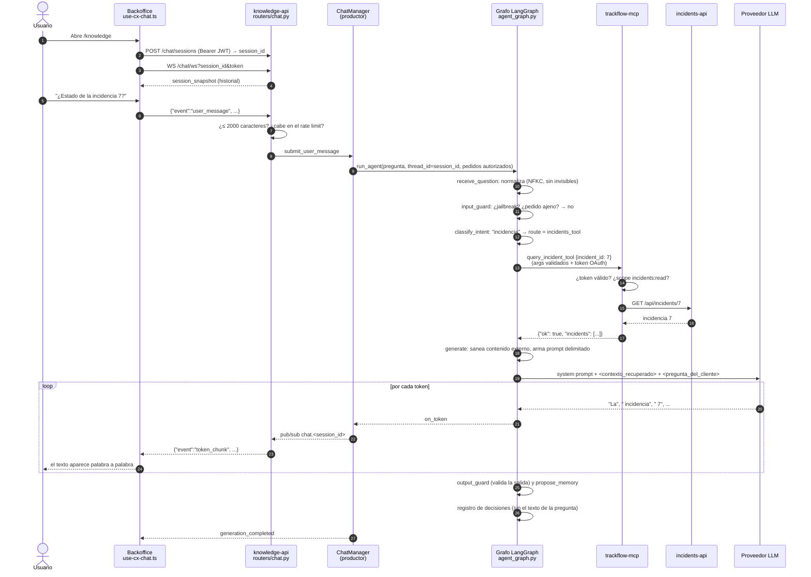
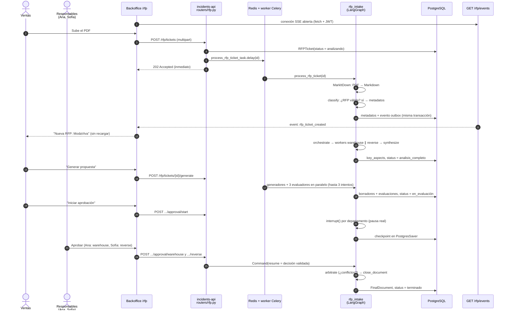
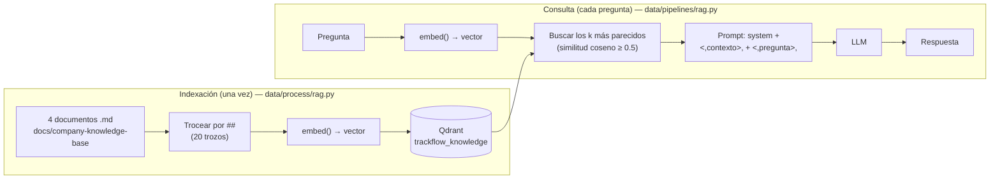
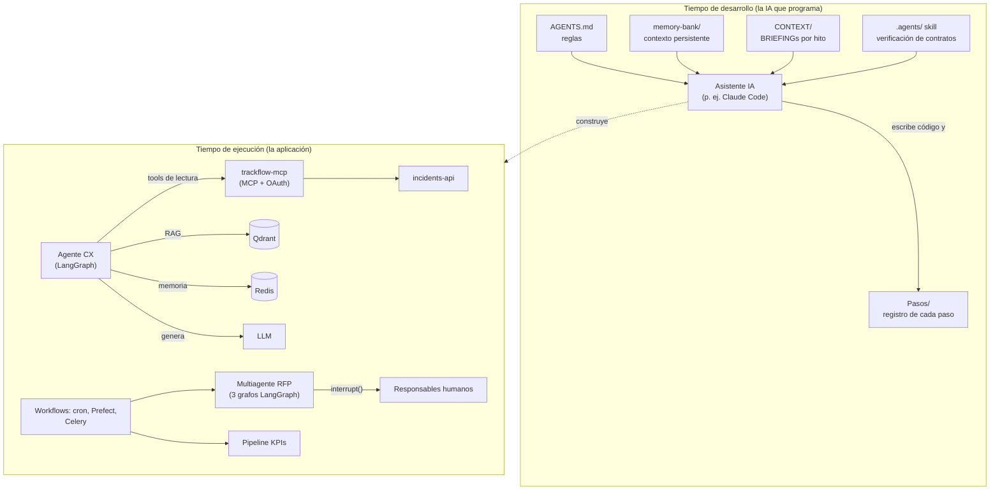

---

## 6. Flujo de datos de principio a fin

> ⚠️ El ejemplo "un usuario registra un camión" **no existe** en TrackFlow: no hay ningún modelo de camiones ni de flota. Los tres casos de abajo son **reales** y se pueden seguir en el código.

### Caso 1 — Un operario registra una salida de stock

**Situación:** en Zaragoza, un operario despacha 5 unidades de unas zapatillas (SKU `CLT-SNK-W-42-Z`).

**Qué aprender de este caso**

1. El navegador avisa, pero **quien decide es el servidor** (pasos 6 y 34).
2. El stock **se calcula** en el momento, no se lee de una columna.
3. Cada acción importante deja un **evento de telemetría**, que de noche se exporta (paso 21) y cada semana se convierte en KPI (paso 20).

### Caso 2 — Un usuario pregunta al agente por una incidencia (chat)

**Situación:** "¿Cuál es el estado de la incidencia 7?", escrito en el chat del backoffice.

**Qué aprender:** la pregunta pasa **4 controles de seguridad** antes de llegar al modelo (longitud, rate limit, normalización e `input_guard`) y otros 2 al salir (`output_guard` y la validación de argumentos de la tool). El agente **nunca** habla directamente con la base de datos: va a través del MCP, con su propio token y solo con permisos de lectura.

> ⚠️ En el repositorio, este flujo se verificó con un LLM **simulado** (generadores de tokens falsos en los tests). Sin las variables `GENERATION_API_*` configuradas, la llamada al LLM real falla.

### Caso 3 — Llega una RFP: de PDF a documento final aprobado

**Situación:** Ventas sube `trackflow-request-1.pdf` (ModaViva, España, pide almacén y devoluciones).

**Qué aprender:** el trabajo pesado nunca bloquea al usuario (202 + Celery); el sistema **se detiene y espera a una persona** de verdad (`interrupt`); y la notificación llega **en el momento exacto** de la clasificación, no al final del proceso.

### Autoevaluación — Sección 6

- **P6.1** En el caso 1, ¿qué pasa si el operario manipula el navegador para saltarse el aviso de stock?
- **P6.2** En el caso 2, enumera los controles de seguridad que atraviesa la pregunta.
- **P6.3** En el caso 3, ¿por qué `POST /rfp/tickets` responde 202 y no 200?
- **P6.4** ¿En qué momento exacto se dispara la notificación SSE de una RFP?

---

## 7. La parte de IA en detalle

> **La verdad, sin adornos (léela antes de la defensa).** En TrackFlow hay **dos tipos** de "inteligencia":
> 1. **Modelos de verdad**: un modelo de ML entrenado (Random Forest) y dos modelos externos que se **llaman** por API (LLM de generación y modelo de embeddings).
> 2. **Agentes deterministas**: el clasificador de intención, la propuesta de memoria, el clasificador de RFP, los generadores y los evaluadores son **reglas y plantillas** escritas en Python, con un "punto de inyección" preparado para sustituirlos por un LLM.
>
> El motivo está documentado en cada paso: el repositorio **no tiene credenciales** del proveedor de LLM del curso (4Geeks). Así que todo lo que necesita un LLM se verificó con sustitutos deterministas. **No digas que el agente "usa GPT" en producción: di que está preparado para usarlo y que se ha validado con dobles de prueba.**

### 7.1 Modelos que hay

| Modelo | Tipo | Dónde | Entra | Sale | ¿Se entrena aquí? |
| --- | --- | --- | --- | --- | --- |
| **LLM de generación** (`GENERATION_MODEL`, por defecto `gpt-4o-mini`) | LLM externo, API compatible con OpenAI | `data/pipelines/rag.py` (`generate_answer`, `astream_answer`) | System prompt + bloques `<contexto_recuperado>` y `<pregunta_del_cliente>` | Texto de respuesta (en el chat, token a token) | No: preentrenado, se **llama** |
| **Modelo de embeddings** (`EMBEDDING_MODEL`, por defecto `text-embedding-3-small`) | Modelo externo | `data/process/rag.py` (`embed`) | Un texto (trozo de documento o pregunta) | Un vector de números | No: se llama |
| **Random Forest + tendencia lineal** | ML clásico (scikit-learn) | `scripts/train_sales_forecast.py` | Mes, estacionalidad (seno/coseno), *lags*, medias móviles | Ingreso mensual estimado + rango | **Sí**: se entrena con 2016-2023 |

### 7.2 Cómo funciona el RAG, paso a paso

**Analogía.** El RAG es un **examen con libro abierto**. El LLM no se ha "estudiado" las políticas de TrackFlow; antes de responder, alguien le busca las 3-5 páginas más relevantes del manual de la empresa y se las pone delante. Por eso responde con datos de la empresa y no inventados.

### 7.3 Cómo se decide qué hace el agente

El agente de atención al cliente es un **grafo** (ver el código en la sección 10). La ruta la decide `classify_intent()` con **palabras clave**:

| Si la pregunta contiene… | Ruta |
| --- | --- |
| ticket, incidencia… y además política, SLA, devolución… | `both`: tool de incidencias **y** RAG |
| ticket, incidencia… | `incidents_tool` |
| stock, inventario, existencias… | `inventory_tool` |
| cualquier otra cosa | `rag` |

### 7.4 Cómo se evalúa si funciona

| Qué | Cómo | Resultado | Archivo |
| --- | --- | --- | --- |
| Recuperación del RAG | Recall@3 sobre 10 preguntas con la sección correcta esperada | **80 %** (8/10), con embedding **léxico** de sustitución | `data/eval/retrieval_recall.json` |
| Enrutamiento del agente | Evals sobre la **traza**: ¿se usó la tool y no el RAG? ¿`retrieve` antes que `generate`? | En verde | `tests/pipelines/test_agent_graph.py` |
| Anclaje | Con `retrieve()` real e índice real, la respuesta contiene "Miguel Torres" (dato del documento de tarifas) | En verde | `test_agent_graph.py` |
| Seguridad del agente | 3 variantes de *jailbreak*, caracteres invisibles, pedidos ajenos, inyección en contenido externo | En verde | `test_agent_guardrails.py`, `tests/services/test_security_agent.py`, `test_secure_by_design_agent.py` |
| Modelo de ventas | R² 0,948; RMSE 3 %; Gini 0,935; PSI 0,05; validación cruzada temporal de 5 *folds* | Sobreajuste ×2,07 | `data/eval/sales-forecast/`, `data/eval/evaluation_report.md` |
| Borradores de RFP | 3 evaluadores (legibilidad, pertinencia, cumplimiento) | Usados dentro del flujo | `data/pipelines/rfp_intake/evaluators.py` |

### 7.5 Limitaciones (lo que debes reconocer)

1. **Sin LLM real verificado.** La *faithfulness* (que el LLM no se invente cifras) **no se ha podido medir**.
2. **El Recall@3 del 80 % no representa al modelo real.** El embedding léxico no entiende sinónimos ("Península Ibérica" ≠ "España"), y de 8 aciertos solo 3 superan `min_score = 0.5`, un umbral que tampoco está calibrado.
3. **Las heurísticas no entienden paráfrasis.** Una pregunta sobre incidencias sin la palabra "incidencia" puede ir al RAG en lugar de a la tool.
4. **El modelo de ventas** se entrenó con solo 120 meses, está sobreajustado y el reparto EE. UU./España es sintético.
5. **El modelo de legibilidad** (Flesch) está calibrado para inglés, por eso el umbral es bajo (10).

### Autoevaluación — Sección 7

- **P7.1** ¿Qué diferencia hay entre "llamar" a un modelo y "entrenar" un modelo? Pon un ejemplo de cada uno en TrackFlow.
- **P7.2** Explica el RAG con la analogía del examen con libro abierto.
- **P7.3** ¿Por qué el 80 % de Recall@3 no demuestra que el RAG funcionará bien en producción?
- **P7.4** ¿Qué componentes llamados "agentes" son en realidad reglas deterministas?

---

## 8. Agentes, MCPs, skills y workflows

### 8.1 Los conceptos, en sencillo

| Concepto | Qué es | Analogía |
| --- | --- | --- |
| **Agente** | Un programa que recibe un objetivo, decide pasos y usa herramientas para cumplirlo (a veces con un LLM decidiendo) | Un **empleado** con una tarea y acceso a ciertas aplicaciones |
| **Tool (herramienta)** | Una función concreta que el agente puede invocar (consultar una incidencia) | Una **aplicación** del ordenador del empleado |
| **MCP** | Un protocolo estándar para exponer tools a cualquier agente, con descubrimiento y autenticación | Un **enchufe universal**: cualquier aparato compatible se conecta sin adaptador |
| **Skill** | Un paquete de instrucciones y recursos reutilizables que enseña a un agente a hacer un tipo de tarea | Un **manual de procedimiento** que el empleado consulta |
| **Workflow** | Una secuencia orquestada de pasos (con o sin IA) que se dispara por un evento o un horario | Una **cadena de montaje** |
| **memory-bank / CONTEXT** | Documentos que dan contexto a la IA que **programa** el proyecto (no a los agentes en ejecución) | El **dosier de bienvenida** de un empleado nuevo |

### 8.2 Los agentes de TrackFlow (en ejecución)

**A) Agente de atención al cliente** (`services/knowledge-api/agent_graph.py`), un único grafo con estos nodos:

| Nodo | Qué hace |
| --- | --- |
| `receive_question` | Normaliza la pregunta |
| `input_guard` | Bloquea *jailbreak*, uso personal, mezcla de países y pedidos ajenos; redirige preguntas casuales |
| `resolve_pending_memory_proposal` | Si había una propuesta de memoria pendiente, la aprueba o rechaza |
| `classify_intent` | Elige la ruta |
| `retrieve_memory` | Busca hechos aprobados en Redis |
| `retrieve` | RAG |
| `incidents_tool` / `inventory_tool` | Llaman al MCP |
| `generate` | Sanea y llama al LLM |
| `no_context` / `tool_failed` / `empty_question` / `guardrail_blocked` | Salidas honestas cuando algo falla o se bloquea |
| `output_guard` | Valida la respuesta |
| `propose_memory` | Propone recordar algo |

**B) Sistema multiagente de RFPs** (`data/pipelines/rfp_intake/`), tres grafos:

1. **Recepción** (`graph.py`): `classify` → `orchestrate` → `warehouse_worker` ∥ `lastmile_worker` ∥ `reverse_worker` → `synthesize`.
2. **Generación y evaluación** (`generation_graph.py`, `evaluation_graph.py`): un generador por departamento y 3 evaluadores en paralelo, más un bucle de corrección en Python.
3. **Aprobación** (`approval_graph.py`): `{dept}_approval` con `interrupt()` → `arbitrate` → `close_document`.

### 8.3 MCP: el servidor `trackflow-mcp`

| Tool | Scope | ¿La puede usar el agente CX? |
| --- | --- | --- |
| `query_incident_tool` | `incidents:read` | ✅ |
| `create_incident_ticket_tool` | `incidents:write` | ❌ (bloqueada por la lista de permitidas del cliente, paso 34) |
| `update_incident_status_tool` | `incidents:write` | ❌ |
| `query_inventory_tool` | `inventory:read` | ✅ |
| `update_inventory_stock_tool` | — (siempre rechaza: `read_only_tool`) | ❌ |

### 8.4 Skills

- `.agents/Verificaciondecontratos.md`: la **única skill escrita** del proyecto. Es para la IA que programa: antes de un commit, detecta si cambiaron "contratos compartidos" (los tipos de `packages/shared/types/**`), clasifica cada cambio (`compatible`, `breaking`, `unknown`) y devuelve `PASS`, `FAIL` o `NO_CONTRACT_CHANGES`.
- `skills/data-analysis/`: un ejemplo genérico de la plantilla del curso (métricas comunes y un script de limpieza con pandas).
- `skills/_template/SKILL.md`, `skills/code-review/` y `skills/research/`: 💤 **vacíos** (plantillas).
- Paso 18: las skills de rendimiento web sugeridas por el CTO **no se instalaron**.

### 8.5 Workflows

La carpeta `workflows/` está **vacía** (solo README; es una ruta protegida por `AGENTS.md`). Los "workflows" reales del proyecto viven en el código:

| Workflow | Disparador | Dónde |
| --- | --- | --- |
| Exportación nocturna + pipeline semanal | cron 02:00 | `scripts/nightly_export.py`, `infra/nightly_export.cron` |
| Pipeline de KPIs | manual, CLI o `POST /reporting/exec-weekly/run` | `data/pipelines/exec_weekly_inventory_kpis/flow.py` (Prefect) |
| Análisis de CSV | `POST /api/incidents/analyze` | Celery, `tasks.py` |
| Procesamiento de RFP | `POST /rfp/tickets` y `/generate` | Celery, `rfp_tasks.py` + LangGraph |

### 8.6 El papel de `memory-bank`, `CONTEXT` y `AGENTS.md`

Estos documentos **no los usa la aplicación en ejecución**. Los usa el **asistente de IA que escribió el código** (por ejemplo, Claude Code):

- `AGENTS.md` obliga a leer `memory-bank/` al empezar cada sesión, define un flujo de 5 pasos antes de cada commit y prohíbe tocar rutas protegidas (`infra/`, `mcps/`, `.gitignore`…) sin confirmación. Por eso varios pasos dicen "confirmé con el desarrollador el permiso para modificar `mcps/`".
- `memory-bank/` (`projectbrief.md`, `techContext.md`, `progress.md`) es la **memoria persistente** del proyecto: negocio, stack y estado.
- `CONTEXT/` contiene los **BRIEFINGs** de cada hito: lo que pedía el "cliente", con nombres de personas, campos y reglas exactas. Los pasos citan constantemente estos documentos para no inventar nombres.

### 8.7 Cómo se relaciona todo

### Autoevaluación — Sección 8

- **P8.1** ¿Qué diferencia hay entre una tool y un servidor MCP?
- **P8.2** ¿Por qué el agente CX no puede crear incidencias aunque el MCP tenga esa tool?
- **P8.3** ¿Quién lee `memory-bank/`: la aplicación o el asistente de IA? ¿Para qué?
- **P8.4** ¿Qué hace la skill de verificación de contratos y cuándo se ejecutaría?

---

## 9. Decisiones técnicas

| # | Decisión | Por qué | Alternativa que había | Coste de la decisión |
| --- | --- | --- | --- | --- |
| 1 | **Stock calculado, nunca almacenado** (entradas − salidas) | Una sola fuente de verdad; no se puede "descuadrar" un contador | Columna `stock` que se suma y resta | Cada lectura hace 2 agregaciones (patrón N+1 del paso 12) |
| 2 | **Varios servicios FastAPI** (incidents, knowledge, reporting) en lugar del monolito modular de `ARQUITECTURE_PROPOSAL.md` | Cada hito pedía un servicio "hermano"; separar la IA (dependencias pesadas, otro ritmo de despliegue) | Un único backend con dominios (la propuesta original) | ⚠️ Lo construido **difiere** de la propuesta: dependencias duplicadas, varios venvs, autenticación JWT replicada |
| 3 | **TinyDB para usuarios e incidencias**, PostgreSQL para el resto | Venía de hitos anteriores; cero instalación | Todo en PostgreSQL | Sin transacciones ni concurrencia real; el archivo con usuarios está **versionado en git** (brecha del paso 34) |
| 4 | **Celery + Redis** para tareas pesadas | Respuestas inmediatas (202), reintentos y DLQ, proceso separado | `BackgroundTasks` de FastAPI | Más piezas que operar (worker, broker, Flower) |
| 5 | **Prefect** para el pipeline de KPIs, con staging + UPSERT | Reintentos y estados por tarea; re-ejecución idempotente | Script con cron, Airflow | Sin servidor Prefect, se usa `BackgroundTasks` para `POST /run` |
| 6 | **LangGraph** para los agentes | Ramas, paralelismo, checkpoints e `interrupt()` para aprobación humana | Cadena lineal de llamadas al LLM | Curva de aprendizaje; errores sutiles (carrera de ramas en el paso 31) |
| 7 | **Heurísticas deterministas** con punto de inyección para un LLM | Sin credenciales; tests reproducibles y offline | Llamar a un LLM real | Menos robustas ante paráfrasis |
| 8 | **MCP** entre el agente y el backend, con OAuth y scopes | Estándar, descubrible, permisos por tool | El agente llama a la API con HTTP directo (la versión del paso 25, eliminada) | Más latencia (handshake MCP) y otro servicio |
| 9 | **Redis para la memoria del agente**, no una base vectorial | Los hechos se buscan por clave exacta (`carrier:país`), no por similitud | Guardar en Qdrant | Ninguno relevante; además separa memoria y base de conocimiento |
| 10 | **La memoria solo se escribe con aprobación humana** | Evitar que un usuario "enseñe" algo falso | Escribir automáticamente | Aun así la memoria es **global** (brecha B7 del paso 35) |
| 11 | **Outbox + Last-Event-ID** para el SSE | El evento nace en el worker (otro proceso); el *replay* sale gratis del `id` | Pub/sub en memoria | Consulta a la base cada 1 s por cliente |
| 12 | **`fetch` + `ReadableStream`** en vez de `EventSource` | `EventSource` no puede enviar `Authorization` | `EventSource` con el token en la URL | Hay que escribir el *parser* y la reconexión a mano |
| 13 | **Pub/sub en memoria** para el chat | El BRIEFING lo admitía para un solo proceso | Redis pub/sub | No escala a varios workers sin cambiarlo |
| 14 | **Abort real** (`task.cancel()`) en lugar de `interrupt()` en el chat | `interrupt()` es una pausa con humano, no una cancelación | Ignorar los tokens sobrantes | Hay que gestionar la cancelación en todo el grafo |
| 15 | **ACL de pedidos derivado en el servidor, cerrado por defecto** | El cliente no puede decidir sus propios permisos | Lista enviada por el cliente (paso 28) | Hoy nadie puede consultar pedidos concretos hasta conectar una fuente de propiedad |
| 16 | **scrypt** para contraseñas, con migración en el login | Hash lento y resistente a GPU; sin forzar a nadie a resetear | sha256 de una pasada (lo que había) | Login algo más lento (≈32 MiB de memoria por cálculo) |
| 17 | **Normalizar Unicode antes de los guardrails** | Un carácter invisible evadía todos los patrones | Ampliar las expresiones regulares | Ninguno: es más robusto y no altera el texto normal |
| 18 | **Tests con dobles** (fakes) en lugar de servicios reales | Rápidos, deterministas, sin credenciales | Tests contra Supabase y LLM reales | Riesgo de que lo real se comporte distinto (por eso hay *smoke tests* manuales documentados) |

> **Para la defensa, la decisión 2 es la más delicada.** Si te preguntan por qué no seguiste tu propia propuesta de arquitectura, la respuesta honesta es: la propuesta era un monolito modular pensado para un backend genérico; cada hito del curso pedía un servicio nuevo y separado, y se priorizó cumplir el BRIEFING de cada hito. El resultado se parece más a "servicios por capacidad" que a un monolito. Si volvieras a empezar, unificarías la autenticación en un módulo compartido y migrarías TinyDB a PostgreSQL.

### Autoevaluación — Sección 9

- **P9.1** ¿Por qué el SSE usa `fetch` y no `EventSource`?
- **P9.2** ¿Qué riesgo concreto tiene usar TinyDB para los usuarios?
- **P9.3** Explica por qué la memoria del agente está en Redis y no en Qdrant.
- **P9.4** ¿En qué se diferencia lo construido de `docs/ARQUITECTURE_PROPOSAL.md`?
